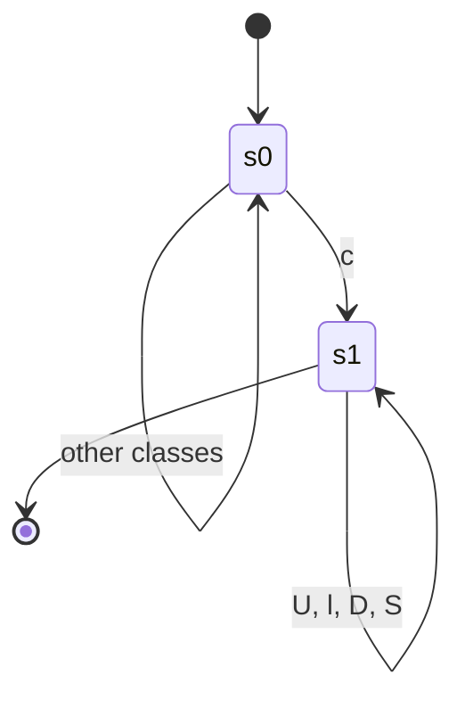
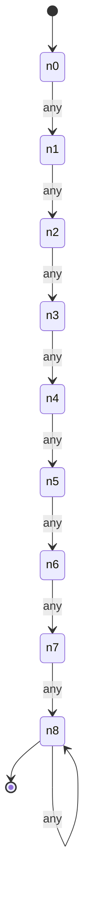
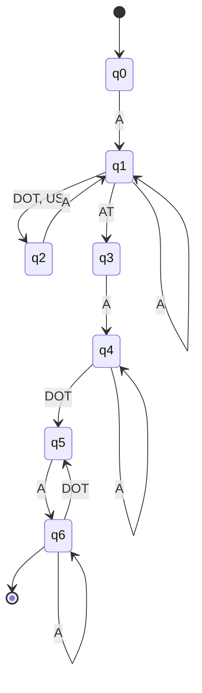
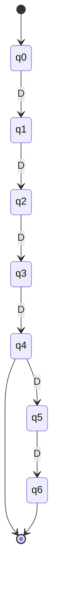

# Task 2 – Designing Automata for Real-Time Applications

**Course:** 21CSC301T Formal Language and Automata  |  **CO:** CO1, CO2, CO3  |  **SDG 9 (Level 2 – Design alignment)**
**Student:** _<Name, Reg. No.>_

## 1. Aim and scope
Design finite automata (DFA) for three input-validation applications – **password verification**, **e-mail format validation** and **ATM PIN verification** – define each language, justify every transition, test with accepted/rejected strings and state the limits of the model.

**SDG 9 link.** Input validation is the first line of defence of digital infrastructure. A formally specified validator is predictable, testable and runs in O(n) time with O(1) memory, which supports reliable and secure systems (SDG 9, Industry, Innovation and Infrastructure).

**Syntax vs. semantics.** A DFA decides only *syntax* ("does the string have the right shape?"). *Semantic / business rules* (is this e-mail really registered? does the PIN match the account? is the card blocked?) need databases, counters or cryptography and are **outside** the automaton.

---
## 2. Application 1 – Password verification

**Assumptions (policy).** A password is valid iff it
1. has length ≥ 8,
2. contains at least one upper-case letter, one lower-case letter, one digit and one special character from `! @ # $ % ^ & *`,
3. contains no other symbols (no spaces, no non-ASCII).

**Alphabet (symbol classes).** Σ = {U, l, D, S}, where U = `A–Z`, l = `a–z`, D = `0–9`, S = `!@#$%^&*`. Any other character has no transition → implicit dead state → reject.

**Language.** L_pw = { w ∈ Σ\* : |w| ≥ 8 ∧ w has a U ∧ w has an l ∧ w has a D ∧ w has an S }.

**Design idea – product (intersection) of five small DFAs.** A single hand-drawn DFA would have to track 4 flags and a length counter together. Because regular languages are closed under intersection, we design five tiny DFAs and combine them with the *product construction* (`dfa.py → intersect`).

Component "has class c" (4 copies, c ∈ {U,l,D,S}) – 2 states:


Component "length ≥ 8" – 9 states (counter saturates at 8):


**Product DFA.** States are 5-tuples (n, hasU, hasL, hasD, hasS); start = (0,0,0,0,0); a symbol class moves every component simultaneously; the accepting states are those where all five components are accepting, i.e. n = 8 and all four flags = 1. Reachable states: **104** (computed by the program; the naive bound is 9 × 2⁴ = 144).

**Design comparison.** *Monolithic DFA:* one big table, hard to change. *Product of components:* each rule is verified separately, adding a rule = adding one component, but the state count multiplies. Both accept the same language; the product design is easier to audit.

| # | Accepted | Why | | # | Rejected | Why |
|---|----------|-----|---|---|----------|-----|
| 1 | `Abcdef1!` | all 4 classes, length 8 | | 1 | `abcdefg1!` | no upper-case |
| 2 | `Zz9#Zz9#` | all classes | | 2 | `ABCDEFG1!` | no lower-case |
| 3 | `Passw0rd!` | length 9 | | 3 | `Abcdefgh!` | no digit |
| 4 | `Hello@2026` | length 10 | | 4 | `Abcdefg1` | no special |
| 5 | `aB3$aB3$aB3$` | length 12 | | 5 | `Ab1!` | too short |
| | | | | 6 | `Abcdef1! x` | space ∉ Σ |

---
## 3. Application 2 – E-mail format validation

**Assumptions.** Simplified format `local@domain` where
* local part = one or more alphanumeric runs separated by a **single** `.` or `_` (no leading/trailing/double separator),
* domain = alphanumeric labels separated by single dots, with **at least one dot**.

**Alphabet.** Σ = {A, DOT, US, AT}, A = ASCII letter or digit, DOT = `.`, US = `_`, AT = `@`.

**Language (regular expression).** `A+ ((DOT|US) A+)* AT A+ (DOT A+)+`


All unlisted moves go to the (implicit) dead state.

**Meaning of the states.** q0 start · q1 inside local part after an alphanumeric · q2 just after a separator (an alphanumeric is mandatory) · q3 just after `@` · q4 inside first domain label (no dot yet → not acceptable) · q5 just after a domain dot (label must follow) · **q6 accepting**: domain has ≥ 1 dot and ends with a label.

| # | Accepted | | # | Rejected | Why |
|---|----------|---|---|----------|-----|
| 1 | `john.doe@srm.edu` | | 1 | `john@@x.com` | two `@` |
| 2 | `a_b@mail.com` | | 2 | `.john@x.com` | starts with separator |
| 3 | `user123@gmail.co.in` | | 3 | `john@x` | no dot in domain |
| 4 | `X@y.z` | | 4 | `john@x.` | ends with dot |
| 5 | `first.last_name@a1.b2.c3` | | 5 | `john..doe@x.com` | double dot |
| | | | 6 | `john doe@x.com` | space |
| | | | 7 | `john@.com` | label missing |
| | | | 8 | `@x.com` | empty local part |

---
## 4. Application 3 – ATM PIN verification

**Assumption.** A PIN is **exactly 4 or exactly 6 decimal digits**. Σ = {D}, D = `0–9`.

**Language.** L_pin = { D⁴ } ∪ { D⁶ }  (finite ⇒ regular).


After the 6th digit there is no move (dead). q4 and q6 are accepting, so `1234` and `123456` pass but `12345` (stuck in non-accepting q5) fails.

| # | Accepted | | # | Rejected | Why |
|---|----------|---|---|----------|-----|
| 1 | `1234` | | 1 | `123` | too short |
| 2 | `0000` | | 2 | `12345` | 5 digits |
| 3 | `987654` | | 3 | `1234567` | 7 digits |
| 4 | `0007` | | 4 | `12a4` | letter |
| 5 | `123456` | | 5 | `` (empty) | nothing entered |
| | | | 6 | `12 34` | space |

---
## 5. When is a finite automaton enough?
| Requirement | DFA enough? | Reason |
|-------------|-------------|--------|
| Length bounds, character classes, fixed formats | **Yes** | finite memory suffices |
| "At most 3 wrong PIN attempts" | Technically yes (4 counter states) but belongs in business logic | stateful policy, changes at run-time |
| PIN equals the PIN stored for this card | **No** | depends on external data; needs lookup + hashing |
| E-mail domain really exists / mailbox exists | **No** | needs DNS / SMTP – semantic check |
| Password not in a breached-password list | **No** | membership in a huge changing set |
| Fully RFC-5322 e-mail (nested comments, quoted strings) | **No** | nested comments need a stack → PDA (see Task 3) |

## 6. Limitations of the models
* Pure syntax checkers – they cannot know whether data is *true*.
* The e-mail DFA is a deliberate **subset** of RFC 5322 (no quoted local parts, `+` tags, IDN domains).
* The password product DFA is memoryless about *history* (no "different from last 5 passwords").
* DFA size grows multiplicatively when rules are combined (104 states here).

## 7. Reproduce the demonstration
```bash
python3 validators.py        # prints every accepted/rejected test with the verdict
python3 test_validators.py   # assertion-based tests
```
For the 5-minute demo: show the diagram, run one accepted and one rejected string per application and read the state path from `DFA.run()`.
