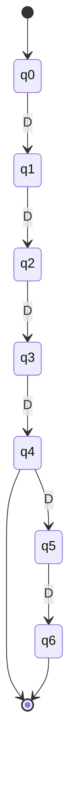
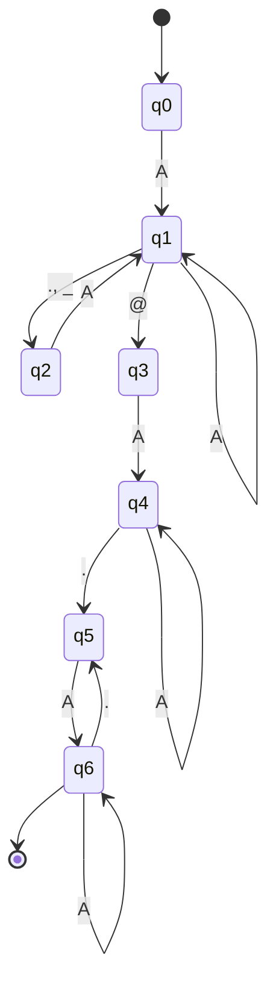
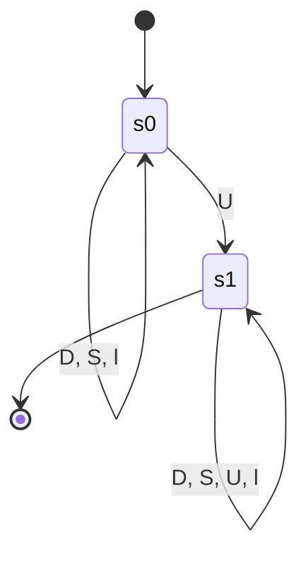

# State diagrams

Generated by `tools/export_mermaid.py`. A missing arrow means a move to the dead state (reject).

## ATM PIN (4 or 6 digits, D = digit)

## E-mail format (A = letter or digit)

## Password: one component DFA, 'contains an upper-case letter'

The full password machine is the product of five such components (see `intersect` in `fa_validators/automata.py`); it is too large to draw by hand.
